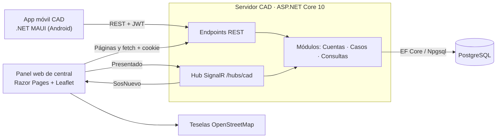

# Arquitectura del Sistema Integrado CAD

Documento de referencia sobre la arquitectura **propuesta** en el *Plan de Arquitectura de Software v1.0* (04/10/2026) y la **implementada** hasta el Sprint 1 (ver [estado-actual.md](estado-actual.md)).

## 1. Arquitectura propuesta

El plan elige un **monolito modular** (ADR-02):

- Un único proceso **ASP.NET Core 10**, el *Servidor CAD*, con la API REST, el Hub SignalR, las páginas Razor del panel y un temporizador de dominio.
- **PostgreSQL** como única fuente de verdad (ADR-03).
- Una **app .NET MAUI** para Android con dos modos, ciudadano y sereno (ADR-01).
- **SignalR solo para notificar**; todas las escrituras van por REST (ADR-04).
- Alojamiento en **Render + Neon**, con plan sin suspensión solo durante la validación (ADR-05).

Dentro del servidor, el código se organiza por **módulos funcionales** (Cuentas, Casos, Despacho, Acompañamiento y Consultas), cada uno con capas ligeras de dominio, aplicación y endpoints. No hay repositorios por entidad ni mediadores.

## 2. Arquitectura implementada

La implementación sigue el monolito modular propuesto. Hoy existen:

- **Servidor CAD** (`src/Cad.Server`): API REST, Hub `/hubs/cad`, panel Razor Pages y persistencia con EF Core.
- **Base de datos CAD**: PostgreSQL 17 en Docker para desarrollo (`docker-compose.yml`).
- **App móvil CAD** (`src/Cad.Movil`): MAUI para Android con login, registro, modo ciudadano (permiso de ubicación y SOS) y modo sereno (solo pantalla base).
- **Contratos** (`src/Cad.Contratos`): DTO y nombres de eventos compartidos.

## 3. Componentes principales

| Componente | Ubicación | Función |
|---|---|---|
| Endpoints REST | `Modulos/*/Endpoints` | Validan el formato, aplican la política de rol y traducen resultados a HTTP |
| Casos de uso | `Modulos/*/Aplicacion` | `ServicioCuentas`, `ServicioSos`, `ServicioPresentacion`, `ConsultasCentral` |
| Dominio | `Modulos/*/Dominio` | `Caso`, `EventoCaso`, `PerfilCiudadano`, `EstadoSereno`, `MedicionPresentacion` |
| Persistencia | `Persistencia/` | `CadDbContext` (Identity + entidades), configuraciones y migraciones |
| Seguridad | `Compartido/Seguridad` | Esquemas JWT y cookie, políticas por rol y emisión de JWT |
| Tiempo real | `TiempoReal/` | `CadHub` y `NotificadorSignalR`, que implementa `INotificador` |
| Panel | `Panel/Pages`, `wwwroot/` | Login, inicio y central (sección urgente con Leaflet) |

## 4. Responsabilidades por proyecto

| Proyecto | Responsabilidad | No debe |
|---|---|---|
| `Cad.Server` | Reglas de negocio, autorización, transacciones, notificación y panel | Delegar reglas al cliente |
| `Cad.Contratos` | DTO (`EmitirSosSolicitud`, `SosCentralDto`, `TokenRespuesta`…) y nombres de eventos (`SosNuevo`, `Presentado`) | Contener lógica |
| `Cad.Movil` | Interfaz MVVM, sesión en `SecureStorage`, ubicación y reintentos del SOS | Decidir el estado de un caso |

## 5. Comunicación entre componentes

| Origen → destino | Mecanismo | Autenticación | Uso actual |
|---|---|---|---|
| App → Servidor | HTTPS + JSON (REST) | JWT Bearer | Registro, token y SOS |
| Navegador → Servidor | Razor Pages + `fetch` | Cookie `cad.panel` (HttpOnly, SameSite Strict) | Login y SOS pendientes |
| Servidor → Panel | SignalR (WebSocket) | Cookie | Evento `SosNuevo` al grupo `operadores` |
| Panel → Servidor (Hub) | SignalR | Cookie | Acuse `Presentado` (medición de RNF02) |
| Servidor → PostgreSQL | Npgsql | Usuario y contraseña en `user-secrets` o variables de entorno | Persistencia |
| Panel → OpenStreetMap | HTTPS | — | Teselas del mapa |

Flujo implementado del SOS: la app envía `POST /api/sos` con su `IdSolicitud`. El servidor guarda el caso y su evento en una transacción y, **después del COMMIT**, emite `SosNuevo`. El panel lo muestra y responde con `Presentado`. Si el panel pierde la conexión, al reconectar vuelve a consultar `GET /api/central/sos-pendientes`.

## 6. Persistencia de datos

- **Motor:** PostgreSQL. EF Core 10 con Npgsql y nombres en snake_case.
- **Migraciones:** `Inicial`, `CasosSos` y `MedicionPresentacion`. Se aplican al arrancar el servidor (`BaseDatos:MigrarAlArrancar`).

| Tabla | Contenido | Garantías |
|---|---|---|
| `usuarios`, `roles`, `usuario_roles`… | Cuentas de Identity y los 4 roles sembrados | Índice único del email normalizado |
| `perfiles_ciudadano` | Nombre y teléfono del ciudadano | Uno a uno con `usuarios` |
| `estados_sereno` | Estado operativo y última posición | CHECK de rango y de posición completa (sin uso todavía) |
| `casos` | SOS con estado, `IdSolicitud` y ubicación opcional | Índice único `(ciudadano_id, id_solicitud)`, CHECK de coordenadas y token `xmin` |
| `eventos_caso` | Historial de actuaciones (solo inserción); `datos` en `jsonb` | FK a `casos` |
| `mediciones_presentacion` | Tiempo de aceptación → acuse (prueba de RNF02) | Un registro por caso |

**Fuente de verdad:** la base de datos. SignalR solo entrega avisos; un evento perdido se recupera consultando la API.

## 7. Diferencias y pendientes respecto al plan

**Implementado de forma distinta o añadido**

| Tema | Plan | Implementación |
|---|---|---|
| Resincronización del panel | `GET /api/central/estado` (SOS, casos, serenos, sesiones y avisos) | `GET /api/central/sos-pendientes` (solo SOS) |
| MVVM en la app | Enlaces de datos de MAUI | Además usa CommunityToolkit.Mvvm |
| Nombres de columnas | No especificado | Convención snake_case (EFCore.NamingConventions) |
| Medición de RNF02 | Tabla `MedicionPresentacion` | Activable con `Mediciones:RegistrarPresentacion` (activa en Development) |

**Pendiente**

- **Temporizador de dominio** (`BackgroundService`): no existe; la carpeta `Temporizador/` está vacía.
- **Módulos sin funcionalidad:** Despacho (solo la entidad `EstadoSereno`) y Acompañamiento (vacío).
- **Cuentas institucionales y semilla del administrador** (HU04, DP02).
- **Claves de Data Protection** en PostgreSQL (`PersistKeysToDbContext`): no configuradas, así que las cookies del panel no sobreviven a un redespliegue.
- **JWT en el Hub para la app** (token por WebSocket): no configurado; la app aún no usa SignalR.
- **Mapsui** en la app (mapa y selección de punto): no incluido.
- **`/salud/lista`**, logs en JSON, HSTS, cabeceras reenviadas para Render y limitador de inicio de sesión: no configurados.
- **Pruebas:** `Cad.Server.Tests` y `Cad.PruebaCarga` vacíos; no hay CI (`.github/workflows`).
- **Despliegue:** existe el `Dockerfile`, pero no hay publicación en Render ni base de datos en Neon.
